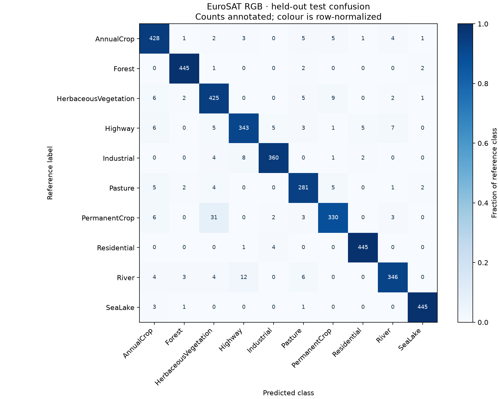
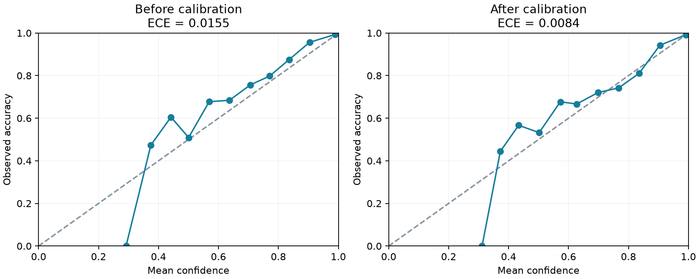

# GeoVision Bench

**Satellite land-cover classification with results you can audit.**

A compact PyTorch experiment built around the parts of machine learning that are easy
to overlook: dataset identity, split leakage, checkpoint selection, probability
calibration, and the mistakes hidden behind a single accuracy score.

The model learns ten land-cover classes from EuroSAT RGB patches. The repository includes
the training pipeline, a non-neural baseline, exact experiment configuration, raw
evaluation reports, and CPU results. It trains from scratch; no downloaded model weights
or hosted inference service are required.



## Measured results

One seed, 12 epochs, 55,642 parameters. The checkpoint was chosen by validation NLL,
then evaluated on the 4,050-image test split. Run on an AMD Ryzen 7 8700G with 32 GB RAM,
Windows, PyTorch 2.15.0 CPU, and four PyTorch threads.

| Method | Test accuracy | Macro F1 | NLL | ECE ↓ |
|---|---:|---:|---:|---:|
| Colour-statistics ridge baseline | 50.05% | 0.4485 | — | — |
| LandCoverCNN | **95.01%** | **0.9482** | 0.1633 | 0.0155 |
| Same CNN + validation-fitted temperature | **95.01%** | **0.9482** | **0.1613** | **0.0084** |

The full training command took **199.1 seconds**, including image loading and checksum
verification. Training-loop process CPU time was **735.5 seconds** across four threads.
These are one-machine measurements, not a throughput comparison or a GPU benchmark.

This is an image-level split, **not a verified geographic holdout**. Spatial neighbours
and near duplicates may inflate generalization estimates. These numbers should not be
compared directly with results using another split, pretrained weights, multispectral
inputs, or geographic evaluation. Read the [model card](docs/model-card.md).

## Reproduce

Python 3.12 is the tested interpreter. Use a fresh virtual environment.

```bash
git clone https://github.com/dimxxkun/geovision-bench.git
cd geovision-bench
python -m venv .venv
# Linux/macOS: source .venv/bin/activate
# Windows PowerShell: .venv\Scripts\Activate.ps1
python -m pip install -r requirements-lock.txt
python -m pip install --no-deps -e .

geovision prepare --data data --seed 2026
geovision train --root data/extracted/EuroSAT_RGB --manifest data/manifest.json \
  --output runs/eurosat --epochs 12 --threads 4
geovision evaluate --root data/extracted/EuroSAT_RGB --manifest data/manifest.json \
  --checkpoint runs/eurosat/best.pt --output runs/eurosat --threads 4
geovision baseline --root data/extracted/EuroSAT_RGB --manifest data/manifest.json \
  --output runs/eurosat/baseline.json --threads 4
```

The multi-line commands above use shell `\` continuations. In PowerShell, put each
command on one line or use its backtick continuation. The first command downloads the
official 94.7 MB archive and verifies its published MD5; SHA-256 values are also recorded.
Expect roughly 1 GB of free disk space for the dataset and environment, plus PyTorch's
installation footprint. The CPU build is pinned in the lock file.

For a short training smoke run, use a new directory:

```bash
geovision train --root data/extracted/EuroSAT_RGB --manifest data/manifest.json --output runs/smoke --epochs 1 --limit 100 --threads 4
```

Smoke checkpoints cannot produce a full benchmark report. Existing run checkpoints
are not overwritten. To classify one original patch after training:

```bash
geovision predict --checkpoint runs/eurosat/best.pt --image data/extracted/EuroSAT_RGB/Forest/Forest_1.jpg
```

Prediction expects a 64 × 64 patch. To use calibrated probabilities, pass the
`calibrated.temperature` value from your own run's `metrics.json` as `--temperature`.
Weights are not committed; the commands above generate them locally.

## What is implemented

| Area | Concrete behaviour |
|---|---|
| Data integrity | Official archive checksum; per-image SHA-256; safe extraction; reject changed image files |
| Split ownership | Seeded 70/15/15 class-stratified allocation; exact duplicates stay together; conflicting duplicate labels fail |
| Training | Seeded shuffling and augmentation, AdamW, cosine decay, finite-loss checks and gradient clipping |
| Reproducibility | Manifest identity embedded in checkpoints; exact dependency versions; environment and raw epoch history |
| Model selection | Lowest validation NLL; test split is not loaded during training |
| Calibration | Scalar temperature fit exclusively on validation logits |
| Evaluation | Accuracy, macro F1, per-class precision/recall, NLL, Brier score, confusion and reliability plots |
| Error analysis | Original paths and confidence for the 24 most confidently wrong test predictions |
| Validation | Complete synthetic train/save/load/evaluate test, repeat-run equality, duplicate and data-drift regressions |



## Inspect the evidence

- [Metrics and per-class results](results/eurosat-cpu/metrics.json)
- [Epoch-by-epoch training history](results/eurosat-cpu/history.json)
- [Dataset provenance and hashes](results/eurosat-cpu/provenance.json)
- [Fixed colour baseline](results/eurosat-cpu/baseline.json)
- [Confident mistakes](results/eurosat-cpu/confident_errors.json)
- [Model card and limitations](docs/model-card.md)

The dataset has 18,900 training, 4,050 validation and 4,050 test images. The full manifest
is regenerated by `prepare`; its recorded digest makes split identity checkable without
committing 27,000 data files. There is one full-data training run in this report, plus
a small pipeline smoke run. No repeated-seed confidence interval is claimed.

The most frequent off-diagonal error was PermanentCrop → HerbaceousVegetation:
31 of 375 PermanentCrop test images. PermanentCrop recall was 88.0%, compared with
98.9% for Forest and Residential. This is a concrete target for label/imagery inspection;
the score alone does not establish whether texture, season, mixed cover, or labelling
is responsible.

## Tests

```bash
pytest -q
ruff check .
ruff format --check .
```

CI uses synthetic images to validate the complete workflow without downloading EuroSAT.
Synthetic test success does not establish real-dataset accuracy; that evidence is in
the committed experiment reports. Full training is intentionally not a CI job.

## Attribution

Built by [Sanusi Abdulfatai Oyewunmi](https://www.sanusiabdulfatai.com), a geospatial
software engineer, with coding-agent assistance. This is a new, reproducible portfolio
experiment; the code, tests and reports are available for inspection.

EuroSAT: Patrick Helber, Benjamin Bischke, Andreas Dengel and Damian Borth.
[Official project](https://github.com/phelber/EuroSAT) ·
[Dataset v2, DOI 10.5281/zenodo.7711810](https://zenodo.org/records/7711810).
Code is MIT licensed. Dataset/source-imagery terms remain with their respective owners.
