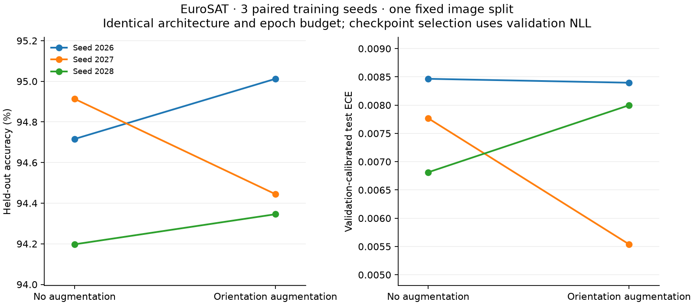

# Paired training-seed and augmentation study

## Question and fixed design

The original report contains one full-data CNN run. This follow-up asks how much its result varies with the training seed, and whether orientation augmentation helps under the same architecture and epoch budget.

The study uses training seeds **2026, 2027 and 2028**. For each seed it runs both training-only orientation augmentation (horizontal/vertical flips and transposition) and no augmentation. All six runs use the same 27,000-image manifest, 55,642-parameter architecture, AdamW settings, batch size and 12-epoch budget. The split seed remains 2026; it is separate from the training seed. Independent generators keep the paired data-loader order unchanged when augmentation is disabled.

The CLI writes `protocol.json` before its training loop and preserves a separate directory for each arm and seed. It selects each checkpoint by minimum validation NLL, fits temperature on validation logits, then evaluates the same fixed 4,050-image test split. All six results are retained. The report does not select the best test-performing seed.

## Interpretation

Mean accuracy was **94.6008% with augmentation** and **94.6091% without it**. The paired
differences were +0.2963, −0.4691 and +0.1481 percentage points. This comparison does not
show a consistent accuracy benefit from augmentation at the chosen training budget.

The [summary](../results/seed-study/summary.json) reports the mean and **sample standard deviation** across the three seeds for each arm, along with per-seed accuracy differences (augmentation minus no augmentation). Accuracy and macro F1 are unchanged by positive scalar temperature; NLL and ECE in this summary are the calibrated values. Complete raw and calibrated metrics remain in each run directory.



Three training seeds describe optimization variability on this one image split. Their standard deviation is not a confidence interval, a geographic generalization estimate, or evidence that an effect will persist on new acquisitions. ECE may vary differently from accuracy because it depends on confidence and binning. Report negative or inconsistent effects as observed.

The same test split had already appeared in the original published run and baseline. This is a declared follow-up comparison on that previously examined split, not a newly untouched final holdout. Further model selection should use validation data and a new final holdout, preferably with verified geographic separation.

## Reproduce

After the main README's environment setup and `geovision prepare`:

```bash
geovision study --root data/extracted/EuroSAT_RGB --manifest data/manifest.json --output runs/seed-study --seeds 2026 2027 2028 --epochs 12 --threads 4
python examples/plot_study.py --summary runs/seed-study/summary.json --output runs/seed-study/paired-seeds.png
```

The study output directory must be empty. The run directories contain configuration, environment, all epoch histories, timing, per-class metrics, and confidently wrong examples. Checkpoints are generated locally and ignored by Git. Source image checksums and the manifest digest bind the study to the declared split. Published timing records describe these executions; they are not an isolated performance comparison between augmentation arms.

The original single-run report stays available at `results/eurosat-cpu/`, so its historical result is not silently replaced by the new mean.
